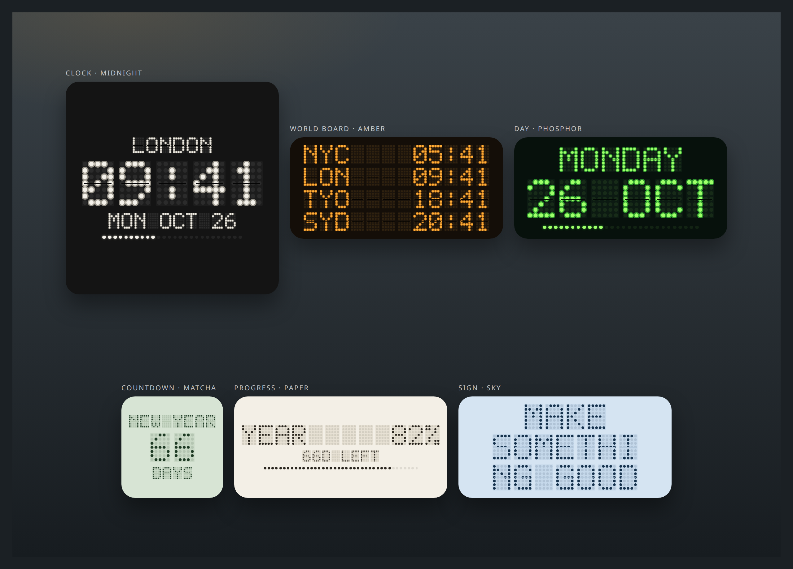
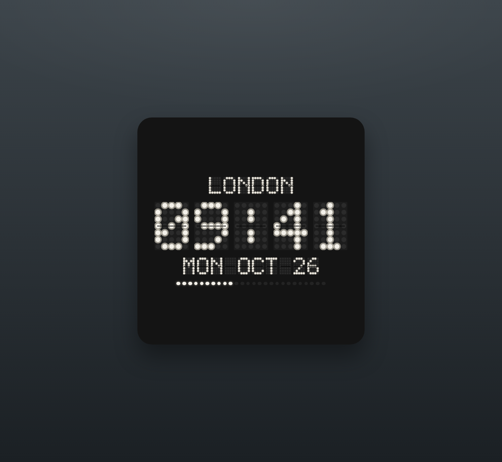
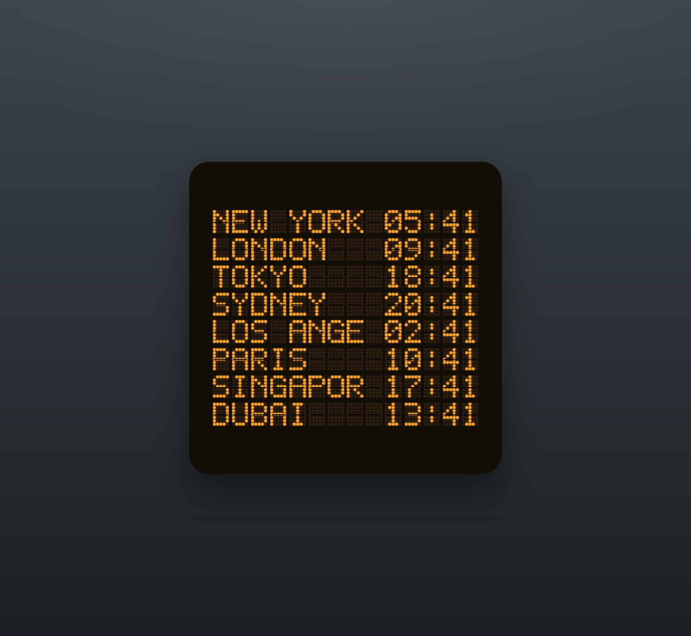
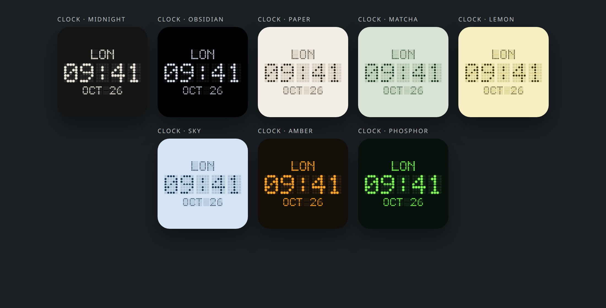
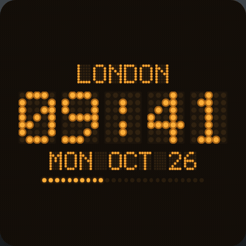

# macdot

Dot-matrix desktop widgets for the Mac. World clocks, a large clock, the date, year progress, a countdown, and a short message.



**[Try it live](https://techieasif.github.io/mac-flip/)** · macOS 14 or later · no account

Macdot is a personal build. There is no account, no analytics, no license check, and no auto-update. Settings stay on the Mac in an App Group.

The widgets target **macOS 14 Sonoma or later**, on Apple silicon and Intel. The live page is the browser preview: the same boards, with a 3D split-flap turn. On the desktop, a changed cell fades instead. WidgetKit cannot run its own animation loop, so the Mac uses SwiftUI’s opacity content transition when the next minute’s timeline entry replaces the last.

## Widgets

| Widget | What it shows | Sizes |
| --- | --- | --- |
| World Board | The cities you list, in order, with the time beside each name | Medium (4), Large (8), Extra Large (7) |
| Clock | One city, the time, and the date. Large adds a day bar | Small, Medium, Large |
| Day | Weekday and date, plus how much of the day has passed. Large adds the week number and day of the year | Small, Medium, Large |
| Progress | Day, week, month, or year, as a percent, a dot bar, and the time left | Small, Medium, Large |
| Countdown | Days until a named moment, then hours and minutes. It reads NOW once that moment has passed | Small, Medium, Large |
| Sign | Your message, wrapped so the dots are as large as they can be | Small, Medium, Large, Extra Large |

Point sizes used by the in-app preview match the desktop widget grid: 164×164, 344×164, 344×344, and 724×344.

Medium World Board shows three-letter codes. Large shows the first eight city names. Extra large shows the first seven names. The city list itself is edited in the app, not on the widget.





## Themes

Midnight, Obsidian, Paper, Matcha, Lemon, Sky, Amber, and Phosphor. Midnight, Obsidian, Amber, and Phosphor glow. The other four are flat. Set one theme for every board, or give a board its own. A desktop widget can also override the theme from Edit Widget.



The boards use a 5×7 Latin uppercase dot font (letters, digits, and basic punctuation). Other scripts are omitted. Diacritics are folded away before the glyphs are looked up.

## A minute on the desk, and in the browser

Desktop widgets do not tick every second. Each one publishes one timeline entry per minute for the next hour, then sleeps until WidgetKit asks for the next hour. When a cell’s character changes, `DotBoard` applies `contentTransition(.opacity)` with a short ease-in-out. That is the desktop flip.

The in-app preview uses the same cells and flips when the minute changes, or as soon as you edit a board. The browser preview, including the [live site](https://techieasif.github.io/mac-flip/), turns a cell in 3D (`rotateX`) for about 180ms. The picture below is that browser turn on the Amber clock, as the minute moves from 09:41 to 09:42. The frames are slowed so the turn is visible.



## Requirements

- macOS 14 or later
- Xcode 15 or later, to build the app
- [XcodeGen](https://github.com/yonaskolb/XcodeGen)

## Build the Mac app

```bash
brew install xcodegen
xcodegen generate
open Macdot.xcodeproj
```

`Macdot.xcodeproj` is generated and gitignored. `project.yml` is the project definition.

Then:

1. Select the **Macdot** target, open **Signing & Capabilities**, and choose your Development Team. Do the same for **MacdotWidgets**.
2. Confirm both targets have the App Sandbox and the App Group `group.dev.macdot.shared`. The group is also written in:
   - `MacdotApp/Macdot.entitlements`
   - `MacdotWidgets/MacdotWidgets.entitlements`
   - `MacdotApp/Info.plist` and `MacdotWidgets/Info.plist` (`AppGroupIdentifier`)
   - `project.yml` (`APP_GROUP_IDENTIFIER`)
   - `Shared/Settings.swift` (`AppGroup.fallback`)
3. If you use a different group id, change that string in every place above, and register the group for your team. The app and the widget must use the same id or the desktop boards will not see what you set.
4. Bundle identifiers are `dev.macdot.app` and `dev.macdot.app.widgets`. Change them in `project.yml` if your team already uses those ids, then run `xcodegen generate` again.
5. Run the **Macdot** scheme. The widget extension is embedded in the app.

The first launch writes default settings: This Mac, New York, London, and Tokyo on the world board, a Midnight theme, a New Year countdown, and the message MAKE SOMETHING GOOD.

## Add widgets to the desktop

1. Open Macdot and set cities, the countdown, the message, and the theme.
2. Right-click an empty spot on the desktop and choose **Edit Widgets**.
3. Search for **Macdot**. Drag World Board, Clock, Day, Progress, Countdown, or Sign onto the desktop at the size you want.
4. Click a widget to open Macdot on that board’s settings. The desktop timeline reloads when you change something.
5. To give one widget its own city, period, message, or theme, right-click it and choose **Edit Widget**. Leave a field on “Match the App” to keep following the companion app.

Tapping a widget opens `macdot://configure/clock` (or `world`, `day`, `progress`, `countdown`, `sign`).

## Project layout

- `Shared/` — themes, the 68-city catalog plus This Mac, settings, the dot font, the flap board, and the layout for each widget. Compiled into both the app and the extension.
- `MacdotApp/` — the companion window: sidebar, editors, and a live preview.
- `MacdotWidgets/` — WidgetKit extension. Six widgets, minute timelines, and App Intents for Edit Widget.
- `WebPreview/` — the browser version of the boards. `board.js` is the renderer. `font.js` is generated from `Shared/DotFont.swift`.
- `site/` — the GitHub Pages landing page. It uses that same renderer.
- `docs/screenshots/` — pictures taken from `WebPreview` in a headless browser.
- `project.yml` — XcodeGen spec.
- `.github/workflows/pages.yml` — deploys `site/` to GitHub Pages.

Settings are a JSON blob in the App Group user defaults (`macdot.settings.v1`). The privacy manifests declare no tracking and no collected data types.

## Try it in the browser

The Mac app cannot be compiled here, so `WebPreview` draws the same boards in the browser, including the split-flap turn when a minute changes. The hosted copy of that preview is [https://techieasif.github.io/mac-flip/](https://techieasif.github.io/mac-flip/). GitHub has to be told to publish it: in the repository, open **Settings → Pages → Build and deployment → Source** and choose **GitHub Actions**.

To run the preview locally:

```bash
cd WebPreview
python3 -m http.server 4731
```

Open http://127.0.0.1:4731 . Pick a widget, a size, and a theme. **Step minute** flips the cells that changed. The page also steps forward on its own until you pause it.

Useful preview links:

- `?shot=wall` — all six widgets
- `?shot=clock` — large Midnight clock
- `?shot=flip` — the minute digit held mid-flip
- `?shot=world` — large Amber world board
- `?shot=themes` — the clock in all eight themes

`font.js` is generated from the glyph table in `Shared/DotFont.swift`. If you change a glyph, regenerate it from the repository root:

```bash
python3 - << 'PY'
import re, json
text = open("Shared/DotFont.swift").read()
font = {}
for key, body in re.findall(r'"([^"]+)": g\((.*?)\)', text, re.S):
    font[key] = re.findall(r'"([01]{5})"', body)
open("WebPreview/font.js", "w").write("window.DOT_FONT = " + json.dumps(font) + ";\n")
PY
```

The Pages workflow copies `WebPreview/board.js` and `WebPreview/font.js` next to the landing page so every asset path stays relative and the site works at `/mac-flip/`.

## License

The Mac app does not check a license. This repository does not include a license file. Until one is added, no permission is granted to copy or distribute the source beyond what you already have.
